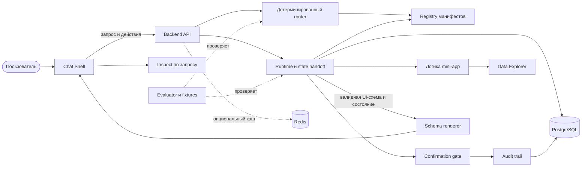

# Архитектура Conversational Mini-App Studio

**Статус:** проектное описание MVP для обсуждения командой. На момент подготовки документа в репозитории есть требования, но нет реализации платформы: схемы и контракты ниже — предложения, а не описание работающего сервиса.

**Ссылка на сайт:** публичный адрес ещё не предоставлен и не зафиксирован. После развёртывания команда добавит сюда URL. [Репозиторий проекта](https://github.com/KekCheburekLegend/practicum-yandex-conversational-mini-app).

## 1. Контекст и границы

Conversational Mini-App Studio — самостоятельная веб-платформа: пользователь отправляет запрос в чат, выбирает или подтверждает предложенное mini-app, работает с его состоянием и возвращает структурированный результат в диалог. Обязательные приложения MVP: Research Board, Project Planner и Data Explorer. Платформа не является приложением ChatGPT и не требует интеграции с OpenAI или Яндекс Диалогами.

Общие требования: детерминированная маршрутизация; registry манифестов; runtime и renderer для ограниченного набора UI-примитивов; версионированное состояние; подтверждение удаления, массового изменения и экспорта; журнал событий; inspect-панель и evaluator. Языковая модель не является обязательной зависимостью MVP. Основание: [требования заказчика](customer_requirement.md).

## 2. Предлагаемый стек

| Область | Выбор / статус | Назначение |
| --- | --- | --- |
| Backend | Python 3.11+, FastAPI, Pydantic | HTTP API и проверка контрактов. |
| Хранение | PostgreSQL, SQLAlchemy, Alembic | Постоянные данные, транзакции, JSONB для версионированного состояния и миграции. |
| Кэш | Redis | Опциональный кэш и временные данные; не источник истины для состояния и аудита. Его конкретное применение согласовать при проектировании. |
| Frontend | React + TypeScript, Vite, CSS Modules, Flexbox и Grid, Fetch API, JSON Schema + Ajv | Адаптивные Chat Shell, renderer и mini-app. |
| Инфраструктура | Docker, Docker Compose, GitHub Actions | Воспроизводимое локальное окружение и автоматическая проверка изменений. Подробности: [DevOps-анализ](devops.md). |

Единый backend как модульный монолит — предложение для MVP: общие контракты и транзакции проще согласовать до появления необходимости в отдельных сервисах. Наличие Docker/Redis в проектном стеке не означает, что они уже настроены.

## 3. Компоненты и границы ответственности

- **Chat Shell** показывает историю, карточку запуска, интерфейс mini-app и полученный итог; inspect скрыт до запроса пользователя.
- **Router** по поддерживаемым правилам выбирает приложение или предлагает ручной выбор, если уверенности недостаточно. Неизвестный запрос не запускает изменяющие действия.
- **Registry** хранит версии манифестов приложений: intents, схемы ввода/вывода, разрешённые действия и версию приложения.
- **Runtime** проверяет манифест и входные данные, создаёт/восстанавливает состояние, принимает действия и формирует итог для чата.
- **Renderer** проверяет версию и структуру UI-схемы, затем отображает только разрешённые примитивы. Невалидные или неизвестные компоненты отклоняются; произвольные HTML/JS не исполняются. Минимум примитивов задан в требованиях заказчика.
- **Confirmation gate и audit** обеспечивают явное подтверждение критических операций и запись их результата. События подтверждения и исполнения должны быть связаны с пользователем, сессией, версией состояния и операцией.
- **Evaluator** проверяет маршрутизацию, валидность схем, сохранность состояния и продуктовые сценарии на offline fixtures.

## 4. Основной сценарий

1. Пользователь вводит запрос и при необходимости прикладывает учебный файл в Chat Shell.
2. Router подбирает приложение из registry или предлагает ручной выбор; Chat Shell показывает карточку запуска.
3. Runtime проверяет входные данные и манифест, создаёт состояние и формирует UI-схему. Renderer проверяет схему и отображает разрешённые компоненты.
4. Действия пользователя изменяют состояние через согласованный контракт; runtime сохраняет новую версию. Перед критическими операциями запрашивается подтверждение; отказ не выполняет операцию.
5. Mini-app передаёт структурированный итог в чат вместе со ссылкой на версию состояния. Inspect по запросу показывает маршрут, аргументы, валидацию и результат без раскрытия секретов.

Для Data Explorer расчёт фильтров, группировки и what-if, проверка файла и воспроизводимость описаны в [аналитике приложения](requirement_Data_Explorer.md).

## 5. Контракты и состояние: предложение к согласованию

Фактические имена полей, транспорт и схема API уточняются командами frontend/backend. Минимальное содержимое state envelope:

| Поле | Назначение |
| --- | --- |
| `session_id`, `app_id` | Сессия и идентификатор приложения. |
| `app_version`, `state_schema_version` | Версии приложения и формата состояния; миграции должны быть явными. |
| `state_version` | Монотонная версия для обнаружения конфликтов одновременных изменений. |
| `payload` | Данные приложения, включая пользовательские правки и ссылки на входные данные. |
| `updated_at` | Время последнего изменения. |

При изменении клиент передаёт ожидаемую версию; при несовпадении сервер не перезаписывает чужую правку и сообщает о конфликте. Для воспроизведения Data Explorer нужны неизменяемый исходный файл или его сохранённая версия, идентификатор/хэш, версия алгоритма и конфигурация фильтров, группировки и what-if. Один хэш без доступного исходного набора недостаточен. Срок хранения данных и стратегия миграции версий требуют согласования.

Итог mini-app должен содержать `app_id`, `session_id`, `state_version` и структурированный результат. Фактическая форма сообщений, схема UI и протокол подтверждения согласуются до реализации, а не считаются готовыми API.

## 6. Модель данных: логические сущности

| Сущность | Основные данные и связи |
| --- | --- |
| Conversation / Message | История диалога и ссылки на запуски/итоги. |
| App manifest | Идентификатор и версия приложения, intents, схемы и разрешённые действия. |
| App session / State version | Связь диалога с приложением; неизменяемые версии состояния и их формат. |
| Dataset | Метаданные и ссылка на сохранённую версию загруженного файла, включая хэш; место хранения согласовать. |
| Confirmation / Audit event | Тип операции, субъект, сессия, версия, решение, время и результат. |

Это логическая модель, не готовая схема таблиц. Авторизацию и права доступа необходимо определить до использования за пределами локального учебного окружения; нельзя полагаться на идентификатор сессии как на механизм доступа.

## 7. Безопасность и эксплуатация

Загруженные файлы проверяются по размеру, формату и структуре до анализа; содержимое не исполняется. Визуализация использует только allowlist примитивов. Секреты не попадают в репозиторий, UI-схемы или журналы; данные и audit не теряются при перезапуске. Экспорт и массовые изменения проходят через confirmation gate; журнал не должен содержать лишние данные загруженных файлов. Нагрузочные лимиты, политика хранения, модель пользователей и восстановление из резервных копий — отдельные решения команды.

## 8. Проверка и открытые решения

- Маршрутизация: не менее 90% точных выборов на размеченном наборе минимум из 90 запросов; неизвестный запрос безопасен.
- UI: невалидная схема или неизвестный компонент отклоняются без исполнения кода.
- Состояние: round-trip чат → приложение → чат сохраняет версию и пользовательские правки; тестируются конфликты версий и восстановление.
- Сценарии: по два end-to-end теста на каждое из трёх обязательных приложений; Data Explorer воспроизводимо применяет фильтр и what-if.
- Операции: удаление, массовое изменение и экспорт требуют подтверждения и отражаются в audit trail.

**Согласовать с командой:** публичный URL сайта; frontend-стек; структуру API и UI-схем; способ хранения файлов и срок жизни данных; аутентификацию; границы использования Redis; CI/CD и среду развёртывания. До принятия решений эти пункты не считаются реализованными.
