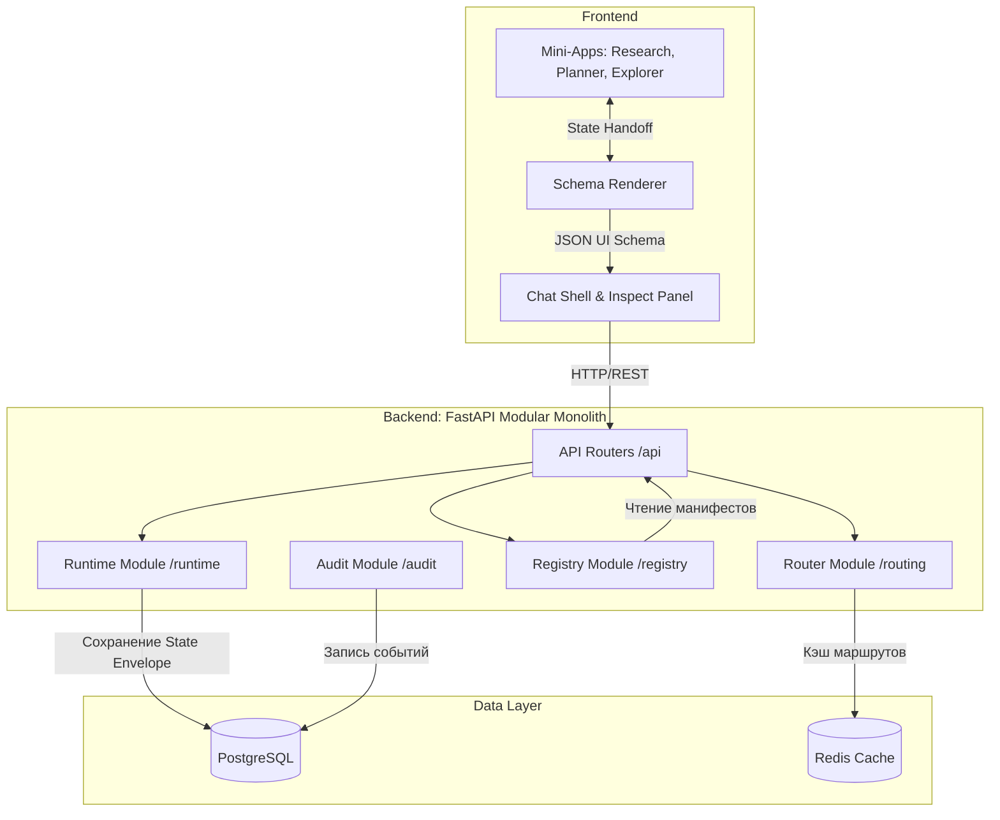

# Архитектура Conversational Mini-App Studio

Данный документ описывает техническую архитектуру платформы, стек технологий, схему базы данных и ключевые архитектурные решения

## 

**Технологический стек:**
*   **Backend:** Python 3.11+, FastAPI, Pydantic
*   **Базы данных:** PostgreSQL, Redis
*   **Frontend:** 
*   **Инфраструктура:** Docker, Docker Compose, GitHub Actions.

### **обоснование выбора стека**

#### **Python**
* **Скорость разработки**
* **Асинхронность:** поддержка `async/await` позволяет не блокировать запросы и простого ожидания
* **автоматическая документация:** Автогенерация документации API (Swagger)

#### **PostgreSQL**
* **Надежность (ACID)**
* **Поддержка формата JSONB**

#### **Redis**
* **кэш:** снижение обращение в БД для поиска постоянной информации, что снижает нагрузку на CPU

## 2. Диаграмма компонентов

