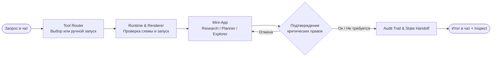

# Conversational Mini-App Studio

## Основная целевая аудитория

`Студенты` `Исследователи` `Проектные команды`

## Проблематика

Студенты, исследователи и проектные команды ежедневно решают сложные аналитические и организационные задачи: сопоставляют тезисы из научных статей, корректируют графики проектов и исследуют табличные данные. Сегодня для этого часто используют текстовые чат-интерфейсы, но линейный диалог для таких задач неэффективен.

### Научное обоснование

1. **Утомляемость от сплошного текста.** Исследования Nielsen Norman Group (NN/g) в области пользовательского опыта показывают, что монотонный текст отпугивает читателей и приводит к быстрому отказу от работы с интерфейсом.

2. **Потеря скорости при повторных действиях.** Исследование Liu et al. (2024) доказало, что чат удобен только для простого первого запроса. При повторяющихся задачах принятия решений графический интерфейс (GUI) значительно превосходит текстовый диалог (CUI) по скорости и удобству.

3. **Снижение точности на сложных задачах.** Работы Speier & Morris (2003) и Figliè et al. (2026) подтверждают, что на сложных задачах визуальные дашборды снижают когнитивную нагрузку и дают более высокую точность, чем текст.

## Наше решение
 это самостоятельная веб-платформа, которая объединяет удобство текстового чата с точностью интерактивных визуальных мини-приложений

## Три базовых мини-приложения

* **Research Board:** связывает утверждения с доказательствами и автоматически подсвечивает тезисы без источников.
* **Project Planner:** отображает график задач и при изменении сроков мгновенно пересчитывает критические конфликты.
* **Data Explorer:** позволяет фильтровать учебные таблицы, строить графики и проверять *what-if* сценарии.

## пользовательский путь

