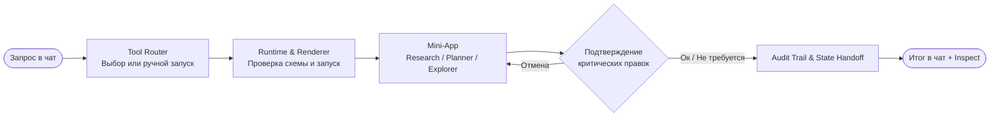

# Conversational Mini-App Studio

## Основная целевая аудитория

`Студенты` `Исследователи` `Проектные команды`

## Проблематика

Студенты, исследователи и проектные команды ежедневно решают сложные аналитические и организационные задачи: сопоставляют тезисы из научных статей, корректируют графики проектов и исследуют табличные данные. Сегодня для этого часто используют текстовые чат-интерфейсы, но линейный диалог для таких задач неэффективен.

### Научное обоснование

1. **Утомляемость от сплошного текста.** Исследования Nielsen Norman Group (NN/g) в области пользовательского опыта показывают, что монотонный текст отпугивает читателей и приводит к быстрому отказу от работы с интерфейсом.

2. **Потеря скорости при повторных действиях.** Исследование Liu et al. (2024) доказало, что чат удобен только для простого первого запроса. При повторяющихся задачах принятия решений графический интерфейс (GUI) значительно превосходит текстовый диалог (CUI) по скорости и удобству.

3. **Снижение точности на сложных задачах.** Работы Speier & Morris (2003) и Figliè et al. (2026) подтверждают, что на сложных задачах визуальные дашборды снижают когнитивную нагрузку и дают более высокую точность, чем текст.

## Наше решение
 это самостоятельная веб-платформа, которая объединяет удобство текстового чата с точностью интерактивных визуальных мини-приложений

## Три базовых мини-приложения

* **Research Board:** связывает утверждения с доказательствами и автоматически подсвечивает тезисы без источников.
* **Project Planner:** отображает график задач и при изменении сроков мгновенно пересчитывает критические конфликты.
* **Data Explorer:** позволяет фильтровать учебные таблицы, строить графики и проверять *what-if* сценарии.

## Прямые конкуренты

| Конкурент | Что делает | Сильные стороны | Слабые стороны / чем мы отличаемся |
| --- | --- | --- | --- |
| OpenAI Apps SDK / ChatGPT Apps | Приложения внутри ChatGPT с интерактивным UI (таблицы, формы, карточки) в ответ на запрос | Огромная аудитория, готовая экосистема, бренд | Полная привязка к OpenAI; Мы строим собственную chat shell, registry и runtime, контролируем схемы и проверяемость |
| MCP Apps | Открытый стандарт Anthropic: приложения с UI работают в разных клиентах | Открытость, растущая экосистема, кроссплатформенность | Это протокол, а не продукт. Мы даём законченную платформу с предсказуемой маршрутизацией и метриками. |
| Google A2UI | Декларативный формат описания интерфейсов, генерируемых агентами | Инфраструктурный стандарт, поддержка Google, универсальность рендеринга | фокус на универсальность, а не на пользовательские сценарии Мы — продукт для конечного пользователя с конкретными рабочими сценариями |

## Косвенные конкуренты

| Конкурент | Что делает | Сильные стороны | Слабые стороны / чем мы отличаемся |
| --- | --- | --- | --- |
| Notion AI | AI-слой внутри workspace: генерация документов, таблиц, баз данных, управление проектами | Зрелые продукты, привычный GUI | Начинают с документа/таблицы, а не с чата; AI встроен в существующий GUI. Мы переворачиваем представление: чат выбирает и запускает GUI |
| Miro  | Бесконечные доски для визуальной коллаборации, диаграмм и планирования | Стандарт индустрии для research boards и planning canvases, богатые возможности |Нет входа через диалог: пользователь сам создаёт доску вручную. У нас Research Board и Project Planner запускаются из чата и возвращают результат в диалог |
| Power BI  | BI-платформы для визуализации данных и дашбордов | Мощная аналитика, корпоративный стандарт, интеграции | Требуют настройки подключений и моделирования; ориентированы на корпоративные хранилища. Наш Data Explorer — учебный CSV/JSON, запуск из чата, what-if без предварительной настройки |

## пользовательский путь

